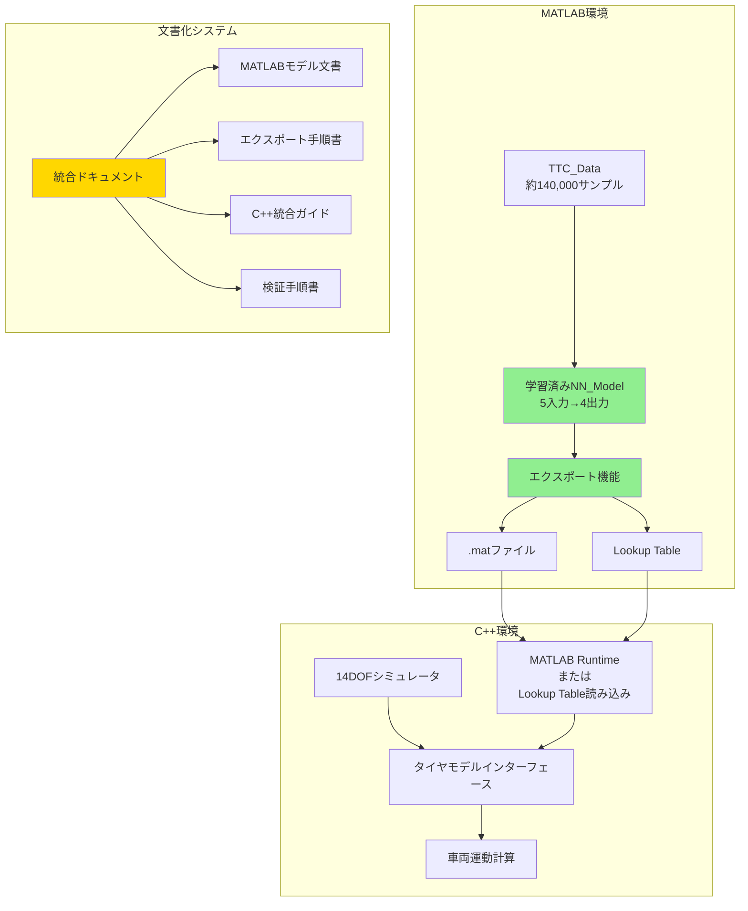
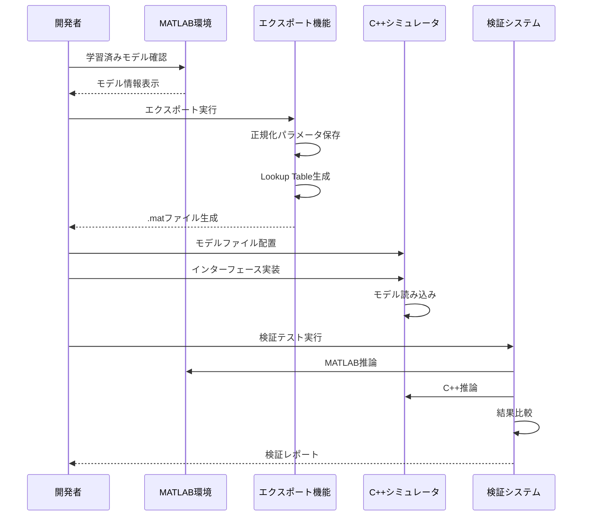

# 設計書: タイヤモデル統合と文書化

## 概要

本設計書は、既に実装・学習済みのMATLABニューラルネットワークタイヤモデルを14DOFシミュレータに統合するための文書化プロジェクトの設計を定義する。約140,000サンプルのTTCタイヤテストデータで学習済みのニューラルネットワークモデルと、そのエクスポート機能は既に完成している。本プロジェクトでは、この既存実装の使用方法、C++シミュレータへの統合手順、検証方法を明確に記述し、他の開発者が容易に理解・利用できるようにする。

### 目的

1. **既存実装の文書化**: MATLABニューラルネットワークタイヤモデルの構造と使用方法を明確化
2. **統合手順の明確化**: エクスポートからC++統合までのワークフローを定義
3. **ドキュメント構造の整理**: 既存プロジェクトドキュメントとの整合性を保つ
4. **再現性の確保**: 他の開発者が文書を読んで実装を理解・利用できるようにする

### スコープ

**含まれるもの:**
- 既存MATLABニューラルネットワークモデルの文書化
- 既存エクスポート機能の使用方法
- C++シミュレータへの統合手順
- 検証とテスト方法
- ドキュメント構造の提案

**含まれないもの:**
- 新しいニューラルネットワークモデルの実装
- 新しい学習アルゴリズムの開発
- TMeasyモデルの修正
- 14DOFシミュレータのコア機能の変更

## アーキテクチャ

### システム構成



### 統合ワークフロー



## コンポーネントとインターフェース

### 1. MATLABニューラルネットワークモデル

#### 1.1 モデルアーキテクチャ

**フィードフォワードネットワーク（標準）:**

```
入力層 (5ニューロン)
  ↓
隠れ層1 (128ニューロン, ReLU, 20% Dropout)
  ↓
隠れ層2 (64ニューロン, ReLU, 20% Dropout)
  ↓
隠れ層3 (32ニューロン, ReLU)
  ↓
出力層 (4ニューロン, 線形)
```

**入力変数 (5変数):**
- SR: スリップ率 (Slip Ratio) [-0.2, 0.2]
- SA: スリップ角 (Slip Angle) [-15, 15] deg
- Fz: 垂直荷重 (Vertical Load) [500, 2500] N
- IA: キャンバー角 (Inclination Angle) [-5, 5] deg
- TSTC: タイヤ表面温度 (Tire Surface Temperature) [20, 80] °C

**出力変数 (4変数):**
- Fx: 前後力 (Longitudinal Force) [-2000, 2000] N
- Fy: 横力 (Lateral Force) [-2000, 2000] N
- Mx: 転覆モーメント (Overturning Moment) [-100, 100] Nm
- Mz: セルフアライニングトルク (Self-Aligning Torque) [-50, 50] Nm

#### 1.2 学習済みモデルの場所

既存の学習済みモデルは以下の場所に保存されている:
- `matlab/dl_tire_model/output/tire_model.mat`
- `matlab/dl_tire_model/output/experiments/models/exp_YYYYMMDD_HHMMSS_model.mat`

#### 1.3 正規化パラメータ

モデルは正規化されたデータで学習されているため、推論時には以下の処理が必要:

**入力の正規化:**
```matlab
X_norm = (X_raw - input_mean) ./ input_std
```

**出力の逆正規化:**
```matlab
Y_raw = Y_norm .* output_std + output_mean
```

正規化パラメータは`norm_params`構造体に保存:
- `input_mean`: 入力の平均値 (5×1ベクトル)
- `input_std`: 入力の標準偏差 (5×1ベクトル)
- `output_mean`: 出力の平均値 (4×1ベクトル)
- `output_std`: 出力の標準偏差 (4×1ベクトル)

### 2. エクスポート機能

#### 2.1 基本エクスポート

**関数:** `exportModel.m`

```matlab
% 使用例
output_path = 'output/tire_model.mat';
exportModel(trained_net, norm_params, output_path);
```

**エクスポートされる内容:**
- `trained_net`: 学習済みニューラルネットワーク
- `norm_params`: 正規化パラメータ

#### 2.2 検証付きエクスポート

**関数:** `exportModelWithValidation.m`

```matlab
% 使用例
output_path = 'output/tire_model_validated.mat';
exportModelWithValidation(trained_net, norm_params, output_path);
```

**検証プロセス:**
1. 元のモデルで推論実行
2. モデルをファイルにエクスポート
3. エクスポートしたモデルを再読み込み
4. 再読み込みしたモデルで推論実行
5. 結果を比較（許容誤差: 1e-10）
6. 検証失敗時はファイルを削除

#### 2.3 Lookup Table生成

**関数:** `generateLookupTable.m`

```matlab
% 使用例
grid_config = struct();
grid_config.SR_range = [-0.2, 0.2, 50];      % 50点
grid_config.SA_range = [-15, 15, 60];        % 60点
grid_config.Fz_range = [500, 2500, 40];      % 40点
grid_config.IA_range = [-5, 5, 20];          % 20点
grid_config.TSTC_range = [20, 80, 20];       % 20点

output_path = 'output/tire_lookup_table.mat';
generateLookupTable(trained_net, norm_params, output_path, grid_config);
```

**Lookup Table構造:**
- `SR_array`, `SA_array`, `Fz_array`, `IA_array`, `TSTC_array`: 各次元の1D配列
- `Fx_grid`, `Fy_grid`, `Mx_grid`, `Mz_grid`: 5次元グリッドの予測値
- `grid_dimensions`: 各次元のサイズ
- `input_names`, `output_names`: 変数名
- `input_units`, `output_units`: 物理単位

### 3. C++統合インターフェース

#### 3.1 統合オプション

**オプション1: MATLAB Runtime使用**
- MATLAB Runtimeをインストール
- .matファイルを直接読み込み
- ニューラルネットワークを実行

**オプション2: Lookup Table使用（推奨）**
- Lookup Tableを生成
- C++で5次元補間を実装
- 依存関係が少ない

#### 3.2 Lookup Table補間（C++）

**疑似コード:**
```cpp
class TireModelNN {
private:
    // Lookup tableデータ
    std::vector<double> SR_array;
    std::vector<double> SA_array;
    std::vector<double> Fz_array;
    std::vector<double> IA_array;
    std::vector<double> TSTC_array;
    
    // 5次元グリッド
    MultiDimArray<double, 5> Fx_grid;
    MultiDimArray<double, 5> Fy_grid;
    MultiDimArray<double, 5> Mx_grid;
    MultiDimArray<double, 5> Mz_grid;
    
public:
    // Lookup tableを読み込み
    void loadLookupTable(const std::string& filepath);
    
    // 5次元線形補間
    TireForces interpolate(double SR, double SA, double Fz, 
                          double IA, double TSTC);
};

struct TireForces {
    double Fx;
    double Fy;
    double Mx;
    double Mz;
};
```

#### 3.3 14DOFシミュレータとの統合

**統合ポイント:**
1. タイヤモデルインターフェースの特定
2. TMeasyモデルとの切り替え機構
3. 入力変数の計算（SR, SA, Fz, IA, TSTC）
4. 出力変数の適用（Fx, Fy, Mx, Mz）

**疑似コード:**
```cpp
// 14DOFシミュレータ内
class VehicleSimulator {
private:
    TireModelNN nn_tire_model;
    bool use_nn_model = true;  // フラグで切り替え
    
public:
    void computeTireForces() {
        for (int i = 0; i < 4; i++) {  // 4輪
            // タイヤ状態を計算
            double SR = computeSlipRatio(i);
            double SA = computeSlipAngle(i);
            double Fz = computeVerticalLoad(i);
            double IA = computeCamberAngle(i);
            double TSTC = getTireSurfaceTemp(i);
            
            // モデル選択
            TireForces forces;
            if (use_nn_model) {
                forces = nn_tire_model.interpolate(SR, SA, Fz, IA, TSTC);
            } else {
                forces = tmeasy_model.compute(SR, SA, Fz, IA);
            }
            
            // 力とモーメントを適用
            applyTireForces(i, forces);
        }
    }
};
```

## データモデル

### 1. TTC_Data構造

**ファイル形式:** CSV

**必須列:**
| 列名 | 型 | 単位 | 説明 | 範囲 |
|------|-----|------|------|------|
| SR | Float | - | スリップ率 | [-0.2, 0.2] |
| SA | Float | deg | スリップ角 | [-15, 15] |
| Fz | Float | N | 垂直荷重 | [500, 2500] |
| IA | Float | deg | キャンバー角 | [-5, 5] |
| TSTC | Float | °C | タイヤ表面温度 | [20, 80] |
| Fx | Float | N | 前後力 | [-2000, 2000] |
| Fy | Float | N | 横力 | [-2000, 2000] |
| Mx | Float | Nm | 転覆モーメント | [-100, 100] |
| Mz | Float | Nm | セルフアライニングトルク | [-50, 50] |

**データセット:**
- DriveBrake-Hoosier18.0×6.0-10-R20.csv: 縦スリップデータ
- Cornering-Hoosier18.0×6.0-10-R20.csv: 横スリップデータ
- 合計: 約140,000サンプル

### 2. 正規化パラメータ構造

```matlab
norm_params = struct();
norm_params.input_mean = [mean_SR; mean_SA; mean_Fz; mean_IA; mean_TSTC];
norm_params.input_std = [std_SR; std_SA; std_Fz; std_IA; std_TSTC];
norm_params.output_mean = [mean_Fx; mean_Fy; mean_Mx; mean_Mz];
norm_params.output_std = [std_Fx; std_Fy; std_Mx; std_Mz];
```

### 3. エクスポートファイル構造

**tire_model.mat:**
```matlab
% 内容
trained_net      % SeriesNetwork オブジェクト
norm_params      % 正規化パラメータ構造体
```

**tire_lookup_table.mat:**
```matlab
% 内容
lookup_table.SR_array       % 1D配列 (N_SR × 1)
lookup_table.SA_array       % 1D配列 (N_SA × 1)
lookup_table.Fz_array       % 1D配列 (N_Fz × 1)
lookup_table.IA_array       % 1D配列 (N_IA × 1)
lookup_table.TSTC_array     % 1D配列 (N_TSTC × 1)
lookup_table.Fx_grid        % 5D配列 (N_SR × N_SA × N_Fz × N_IA × N_TSTC)
lookup_table.Fy_grid        % 5D配列
lookup_table.Mx_grid        % 5D配列
lookup_table.Mz_grid        % 5D配列
lookup_table.grid_dimensions % [N_SR, N_SA, N_Fz, N_IA, N_TSTC]
```


## Correctness Properties

プロパティとは、システムのすべての有効な実行において真であるべき特性または動作のことです。本質的には、システムが何をすべきかについての形式的な記述です。プロパティは、人間が読める仕様と機械で検証可能な正しさの保証との橋渡しとなります。

本プロジェクトは文書化プロジェクトであるため、Correctness Propertiesは文書の完全性と正確性を検証するものです。各プロパティは、生成される文書が特定の情報を含むことを確認します。

### ドキュメント完全性プロパティ

**Property 1: 統合目的の文書化**
*For any* 生成された統合ドキュメント、そのドキュメントはNN_Model統合の主要な目的、TMeasyとの精度比較、予測精度向上のメリット、TTC_Dataベースの利点を含むこと
**Validates: Requirements 1.1, 1.2, 1.3, 1.4**

**Property 2: モデル切り替えシナリオの文書化**
*For any* 比較セクションを含む統合ドキュメント、そのドキュメントはTMeasyとNN_Modelの使い分けシナリオを示すこと
**Validates: Requirements 1.5**

**Property 3: モデル仕様の文書化**
*For any* 生成された統合ドキュメント、そのドキュメントは5つの入力変数（SR、SA、Fz、IA、TSTC）、4つの出力変数（Fx、Fy、Mx、Mz）、モデルアーキテクチャ（層構成、活性化関数、正規化手法）、学習済みモデルファイルの場所と形式、TTC_Dataの構造とサンプル数を含むこと
**Validates: Requirements 2.1, 2.2, 2.3, 2.4, 2.6, 8.5**

**Property 4: エクスポート機能の文書化**
*For any* 生成された統合ドキュメント、そのドキュメントはエクスポート機能の使用方法、呼び出し方法、エクスポートファイル形式、正規化パラメータの形式、生成ファイル一覧、実行スクリプト名、オプション設定を含むこと
**Validates: Requirements 2.5, 3.1, 3.2, 3.3, 3.4, 3.5, 3.6**

**Property 5: C++統合手順の文書化**
*For any* 生成された統合ドキュメント、そのドキュメントはC++エクスポート手順、必要なライブラリ、14DOFシミュレータのインターフェース、正規化処理の説明、モデル切り替え方法、C++サンプルコードを含むこと
**Validates: Requirements 4.1, 4.2, 4.3, 4.4, 4.5, 4.6**

**Property 6: 検証手順の文書化**
*For any* 生成された統合ドキュメント、そのドキュメントは検証手順、MATLAB/C++推論結果の比較方法、許容誤差範囲、統合テストシナリオ、テストデータ準備方法、性能測定方法を含むこと
**Validates: Requirements 5.1, 5.2, 5.3, 5.4, 5.5, 5.6**

**Property 7: ドキュメント構造の文書化**
*For any* 生成された統合ドキュメント、そのドキュメントはNN_Model統合ドキュメントの配置場所、既存ドキュメントとの関係性、既存READMEとの参照関係、言語棲み分けルール、読者別ドキュメント推奨を含むこと
**Validates: Requirements 6.1, 6.2, 6.3, 6.4, 6.5**

**Property 8: データ形式の文書化**
*For any* 生成された統合ドキュメント、そのドキュメントはTTC_Dataのファイル形式、変数の物理的意味と単位、前処理ステップ、正規化パラメータの保存場所と形式、データセット構成を含むこと
**Validates: Requirements 7.1, 7.2, 7.3, 7.4, 7.6**

**Property 9: MATLABスクリプトの文書化**
*For any* 生成された統合ドキュメント、そのドキュメントは主要スクリプトの役割、学習/エクスポート/検証スクリプトの特定、各スクリプトの入力パラメータと出力、既存ドキュメントとの参照関係を含むこと
**Validates: Requirements 8.1, 8.2, 8.3, 8.4**

## エラーハンドリング

### 1. ドキュメント生成エラー

**エラーケース:** 必須セクションが欠落している

**対処:**
- ドキュメントテンプレートを使用
- チェックリストで確認
- レビュープロセスで検証

### 2. 既存ドキュメントとの不整合

**エラーケース:** 既存のREADME.mdやDATA_FORMAT.mdと矛盾する情報

**対処:**
- 既存ドキュメントを参照として使用
- 矛盾がある場合は既存ドキュメントを優先
- 参照リンクを明示

### 3. 技術的詳細の誤り

**エラーケース:** モデルアーキテクチャやパラメータの記述が不正確

**対処:**
- 実装コードを直接確認
- MATLABスクリプトを実行して検証
- 専門家レビューを実施

### 4. コード例の動作不良

**エラーケース:** ドキュメント内のコード例が実行できない

**対処:**
- すべてのコード例を実際に実行してテスト
- 依存関係を明記
- エラーメッセージと対処法を記載

## テスト戦略

### ドキュメント検証アプローチ

本プロジェクトは文書化プロジェクトであるため、テスト戦略は文書の品質と完全性の検証に焦点を当てます。

#### 1. 完全性チェック

**目的:** すべての必須セクションと情報が含まれていることを確認

**方法:**
- チェックリストベースのレビュー
- 各Correctness Propertyに対応するセクションの存在確認
- 必須情報（入力変数、出力変数、アーキテクチャ等）の記載確認

**チェックリスト例:**
```
□ NN_Model統合の目的が記述されている
□ 5つの入力変数すべてが文書化されている
□ 4つの出力変数すべてが文書化されている
□ モデルアーキテクチャ図が含まれている
□ エクスポート手順が記述されている
□ C++統合手順が記述されている
□ 検証方法が記述されている
□ ドキュメント構造が提案されている
```

#### 2. 正確性検証

**目的:** 文書化された情報が実装と一致することを確認

**方法:**
- 実装コードとの照合
- MATLABスクリプトの実行による検証
- パラメータ値の確認

**検証項目:**
- モデルアーキテクチャ（層数、ニューロン数）
- 入出力変数の範囲
- ファイルパスの存在確認
- 関数名とシグネチャ

#### 3. コード例のテスト

**目的:** ドキュメント内のすべてのコード例が実行可能であることを確認

**方法:**
- MATLABコード例の実行
- C++疑似コードの構文チェック
- エラーハンドリングの確認

**テスト対象:**
- エクスポート機能の使用例
- 推論関数の呼び出し例
- Lookup Table生成例
- C++統合コード例

#### 4. 整合性チェック

**目的:** 既存ドキュメントとの整合性を確認

**方法:**
- 既存README.mdとの比較
- DATA_FORMAT.mdとの整合性確認
- 総合ガイドとの矛盾チェック

**確認項目:**
- 用語の統一
- データ形式の一致
- パラメータ値の一致
- 参照リンクの正確性

#### 5. 可読性レビュー

**目的:** 対象読者が理解できる文書であることを確認

**方法:**
- 専門家レビュー
- 初心者による理解度テスト
- フィードバック収集

**評価基準:**
- 技術用語の適切な説明
- 図表の明確性
- 手順の明確性
- 例の適切性

### テスト実行計画

#### フェーズ1: ドラフト作成後

1. 完全性チェック実施
2. 必須セクションの追加
3. 初期レビュー

#### フェーズ2: 詳細記述後

1. 正確性検証実施
2. 実装コードとの照合
3. コード例のテスト

#### フェーズ3: 最終化前

1. 整合性チェック実施
2. 既存ドキュメントとの比較
3. 可読性レビュー

#### フェーズ4: 公開前

1. 最終レビュー
2. すべてのチェックリスト項目の確認
3. フィードバック反映

### 成功基準

文書化プロジェクトが成功したと判断する基準:

1. **完全性:** すべてのCorrectness Propertiesが満たされている
2. **正確性:** 実装と文書の内容が一致している
3. **実行可能性:** すべてのコード例が実行できる
4. **整合性:** 既存ドキュメントと矛盾がない
5. **可読性:** 対象読者が理解できる
6. **再現性:** 文書を読んで統合作業を実行できる

### ドキュメント品質メトリクス

- **完全性スコア:** 必須セクション数 / 含まれるセクション数 × 100%（目標: 100%）
- **正確性スコア:** 正確な情報数 / 検証した情報数 × 100%（目標: 100%）
- **コード例成功率:** 実行成功したコード例数 / 総コード例数 × 100%（目標: 100%）
- **整合性スコア:** 整合性のある項目数 / 検証した項目数 × 100%（目標: 100%）

## 実装ノート

### ドキュメント作成ツール

**推奨ツール:**
- Markdown エディタ（VS Code、Typora等）
- Mermaid（図表作成）
- MATLAB Live Editor（コード例の検証）

### ドキュメント構造

**推奨ファイル構成:**
```
docs/
├── tire-model-integration/
│   ├── README.md                    # 統合ガイド（本文書）
│   ├── matlab-model-reference.md    # MATLABモデルリファレンス
│   ├── export-guide.md              # エクスポートガイド
│   ├── cpp-integration-guide.md     # C++統合ガイド
│   ├── validation-guide.md          # 検証ガイド
│   └── figures/                     # 図表
│       ├── architecture.png
│       ├── workflow.png
│       └── integration.png
```

### 既存ドキュメントとの関係

**参照関係:**
- `matlab/dl_tire_model/README.md` → 詳細な実装ガイド（参照）
- `matlab/dl_tire_model/DATA_FORMAT.md` → データ形式仕様（参照）
- `matlab/dl_tire_model/IMPROVED_TRAINING_GUIDE.md` → 学習改善ガイド（参照）
- `docs/タイヤフィッティング設計書.md` → TMeasyフィッティング（関連）
- `学生フォーミュラ車両運動シミュレーション総合ガイド.md` → 総合技術ガイド（親文書）

**統合方針:**
- 既存の詳細ドキュメントは維持
- 統合ガイドは概要と統合手順に焦点
- 詳細は既存ドキュメントへの参照リンク
- 重複を避け、参照関係を明確化

### 言語棲み分け

**日本語ドキュメント:**
- 統合ガイド（本文書）
- 総合技術ガイド
- 設計書

**英語ドキュメント:**
- MATLABスクリプトのREADME
- データ形式仕様
- コード内コメント

**バイリンガル:**
- 重要な技術用語は日英併記
- コード例は英語コメント

### 対象読者別推奨

**初心者（学生フォーミュラチームメンバー）:**
1. 学生フォーミュラ車両運動シミュレーション総合ガイド.md
2. docs/tire-model-integration/README.md（本文書）
3. matlab/dl_tire_model/README.md（必要に応じて）

**開発者（シミュレータ実装者）:**
1. docs/tire-model-integration/README.md（本文書）
2. docs/tire-model-integration/cpp-integration-guide.md
3. matlab/dl_tire_model/README.md

**研究者（モデル改善者）:**
1. matlab/dl_tire_model/README.md
2. matlab/dl_tire_model/IMPROVED_TRAINING_GUIDE.md
3. matlab/dl_tire_model/DATA_FORMAT.md

## 参考文献

### プロジェクト内ドキュメント

- `matlab/dl_tire_model/README.md` - MATLABニューラルネットワークタイヤモデル実装ガイド
- `matlab/dl_tire_model/DATA_FORMAT.md` - データ形式仕様
- `matlab/dl_tire_model/IMPROVED_TRAINING_GUIDE.md` - 学習改善ガイド
- `docs/タイヤフィッティング設計書.md` - TMeasyパラメータフィッティング仕様
- `学生フォーミュラ車両運動シミュレーション総合ガイド.md` - 総合技術ガイド
- `docs/設計書_統合版.md` - 統合設計書

### 外部リソース

- MATLAB Deep Learning Toolbox Documentation
- TTC (Tire Test Consortium) データ仕様
- 14DOFシミュレータ仕様書（プロジェクト内）
